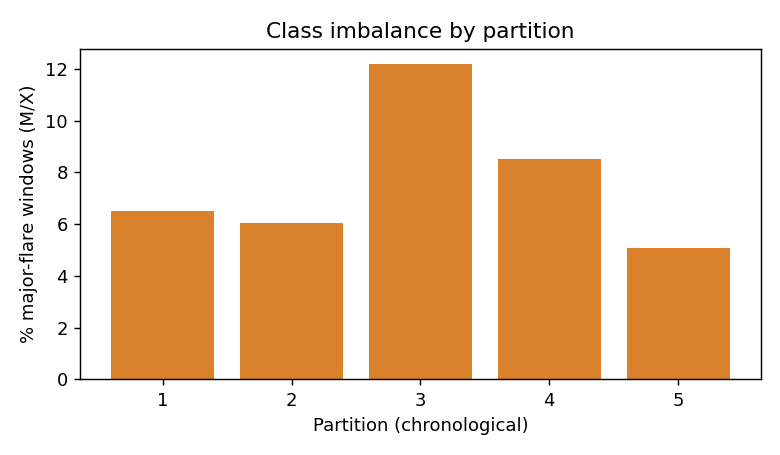
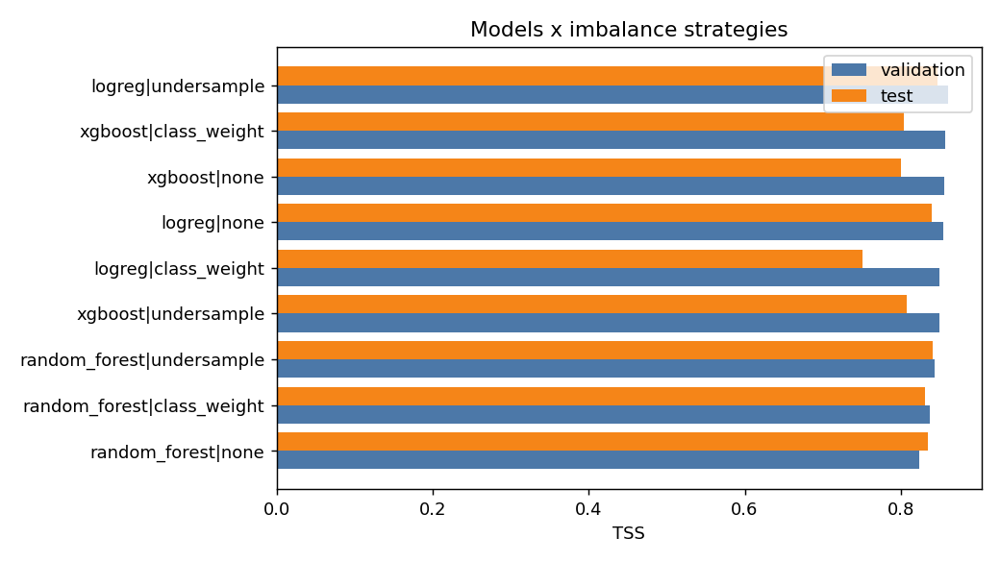
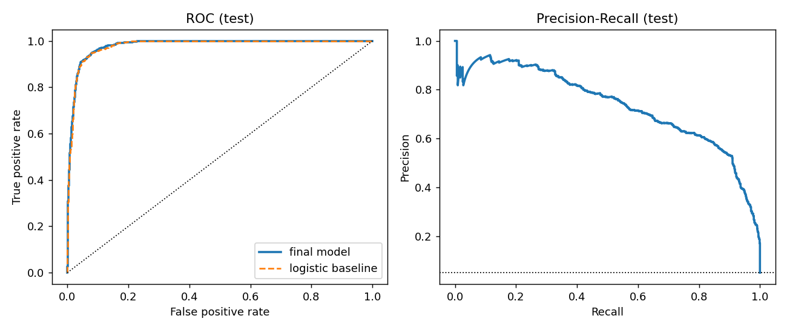
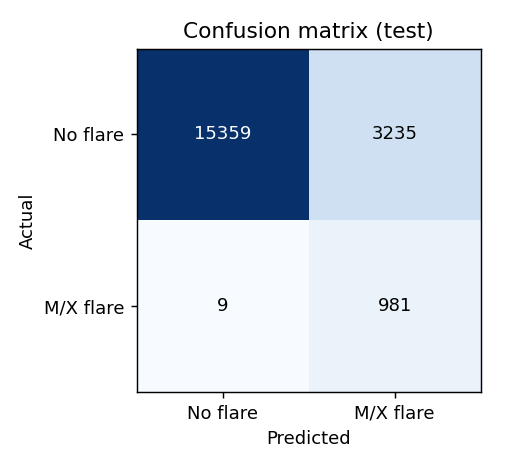
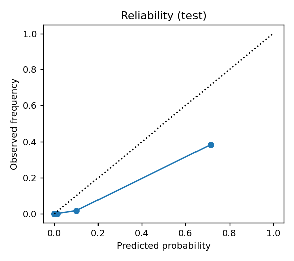
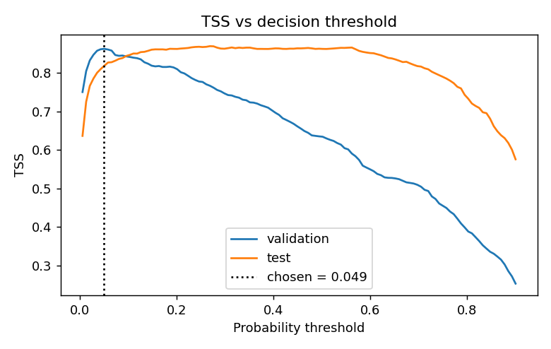
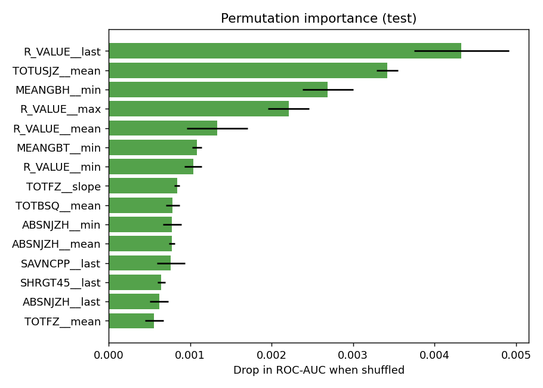
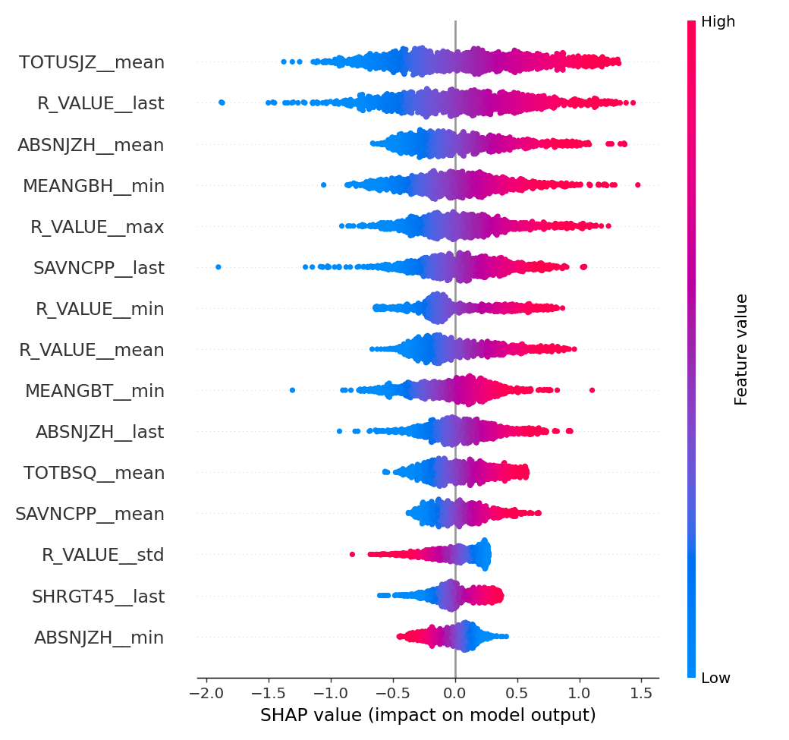

# Solar Flare Prediction - Results Report

> **Data:** Cleaned SWAN-SF (EskandariNasab et al., 2024), `test/` files: FPCKNN imputation and LSBZM normalisation were applied upstream; no resampled or synthetic (TimeGAN) windows are used. Labels are binary (M/X vs everything else), so no per-flare-class breakdown is available.

## 1. Problem
Predict whether a solar active region will produce an **M- or X-class flare within the next 24 hours**, from a 12-hour window of photospheric magnetic-field parameters. Binary classification, heavily imbalanced.

## 2. Data
- Source: `cleaned`; 87473 windows, 168 raw summary features
- Major-flare rate: 7.13% (all M/X windows kept, only 25% of B/C/quiet windows sampled, so this is higher than the true rate; TSS, recall and false-alarm rate are unaffected, precision and Brier score are not)
- Missing cells: 0.00%; duplicate rows: 72
- Chronological split: train partitions [1, 2, 3], validation [4], test [5]. Test data is never used to choose anything.

## 3. Preprocessing
The cleaned dataset is already imputed and normalised, so the pipeline only keeps safety nets: infinite values to NaN, drop columns >40% missing, median imputation of any residual NaN, then standardisation. Winsorising and log transforms are skipped because the values are already normalised. Each 12-hour window is summarised into mean/std/min/max/last/delta/slope per parameter. All steps are fitted on training data only (inside the pipeline).

## 4. Feature selection
| method             |   n_features |   val_ROC_AUC |   val_TSS |   fit_seconds | selected   |
|:-------------------|-------------:|--------------:|----------:|--------------:|:-----------|
| none               |          168 |        0.9701 |    0.835  |          10.7 | False      |
| corr               |           93 |        0.9641 |    0.8096 |          13   | False      |
| corr+mutual_info   |           30 |        0.9733 |    0.857  |          48.5 | True       |
| corr+rf_importance |           30 |        0.956  |    0.8196 |          19.1 | False      |
| corr+rfe_logreg    |           30 |        0.963  |    0.8002 |          13.1 | False      |

## 5. Model comparison (3 models x 3 imbalance strategies)
| candidate                  |   cv_ROC_AUC_train |   val_TSS |   val_ROC_AUC |   test_TSS |   test_HSS |   test_ROC_AUC |
|:---------------------------|-------------------:|----------:|--------------:|-----------:|-----------:|---------------:|
| logreg|undersample         |              0.962 |     0.86  |         0.976 |      0.847 |      0.408 |          0.981 |
| xgboost|class_weight       |              0.958 |     0.857 |         0.973 |      0.804 |      0.295 |          0.968 |
| xgboost|none               |              0.961 |     0.856 |         0.969 |      0.8   |      0.29  |          0.973 |
| logreg|none                |              0.96  |     0.855 |         0.975 |      0.84  |      0.387 |          0.98  |
| logreg|class_weight        |              0.959 |     0.85  |         0.974 |      0.751 |      0.681 |          0.98  |
| xgboost|undersample        |              0.96  |     0.85  |         0.967 |      0.807 |      0.298 |          0.974 |
| random_forest|undersample  |              0.962 |     0.844 |         0.969 |      0.841 |      0.481 |          0.974 |
| random_forest|class_weight |              0.96  |     0.837 |         0.967 |      0.832 |      0.393 |          0.973 |
| random_forest|none         |              0.961 |     0.823 |         0.965 |      0.835 |      0.457 |          0.975 |

## 6. Tuning
Randomized search (12 iterations, leave-one-partition-out CV) on `logreg` / `undersample`. Validation AUC: tuned 0.977 vs default 0.976 -> used **tuned**.

Best parameters: `{'C': 0.01}`

## 7. Final test results (logreg (undersample))
Probabilities are Platt-calibrated on the validation partition; the decision threshold (0.049) maximises TSS on validation.

| Metric | Final model | Logistic baseline |
|---|---|---|
| TSS | **0.817** | 0.751 |
| HSS | 0.321 | 0.681 |
| Recall | 0.991 | 0.775 |
| Precision | 0.233 | 0.636 |
| ROC-AUC | 0.981 | 0.980 |
| PR-AUC | 0.737 | 0.746 |
| Brier skill score | 0.199 | - |

95% block-bootstrap intervals on the test partition: TSS 0.808 to 0.824, recall 0.984 to 0.996 (logistic baseline TSS 0.724 to 0.777). If the intervals overlap, the improvement over the baseline is not statistically convincing.

Confusion matrix (test): TP=981, FN=9, FP=3235, TN=15359

 

## 8. Explainability
Most influential physical parameters (summed permutation importance): `R_VALUE`, `TOTUSJZ`, `MEANGBH`, `ABSNJZH`, `TOTFZ`.

## 9. Limitations and future work
- Only photospheric magnetic-field summary statistics are used; adding EUV/AIA texture features, flare history and sequence models (LSTM/Transformer on the raw time series) are natural extensions.
- Flare forecasting skill is modest even for state-of-the-art models; TSS values should be read against published SWAN-SF benchmarks, not against 1.0.
- Partitions are time-ordered but active regions can span partitions boundaries; limb-region data are less reliable.
- The test set is one partition with a limited number of M/X events and strongly overlapping windows, so a single TSS value is uncertain (see the bootstrap interval). Model and threshold selection also rest on one validation partition.
- Threshold optimised for TSS; an operational user may prefer a different recall/false-alarm trade-off (the dashboard has a threshold slider).
